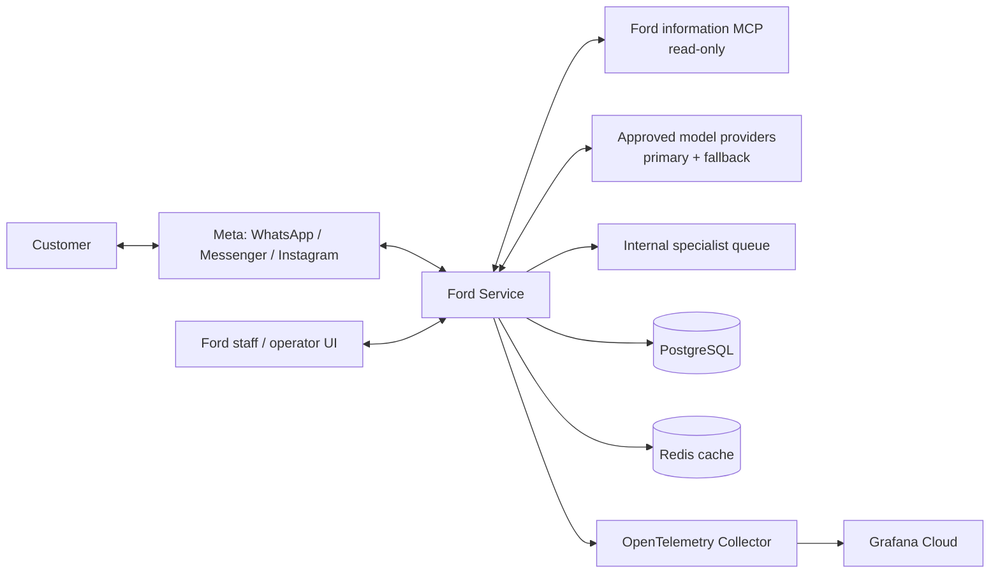
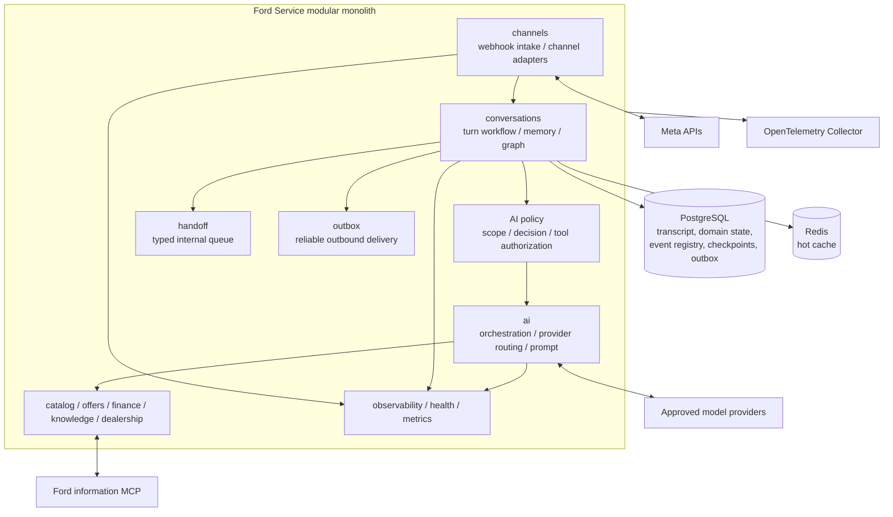
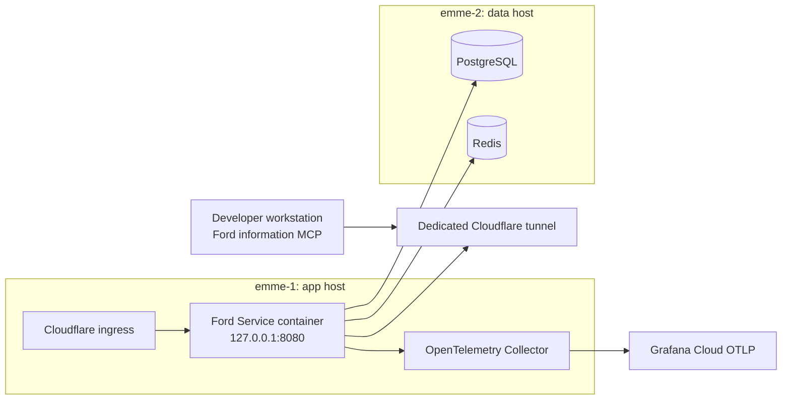

# Ford Service Enterprise Architecture

**Status:** Current-state baseline with approved target guardrail design
**Last reviewed:** 2026-10-07
**System:** Ford Uruapan customer conversation service

This document is the current architecture index for the Ford Service app. It distinguishes repository-defined design from production observations. Older decision documents remain historical records; their implementation/status statements may be stale.

## 1. Business architecture

### Mission and capabilities

Ford Service supports customer conversations for:

- Ford vehicle discovery, catalog details, comparisons, and availability.
- Published promotions and financing information from approved sources.
- Dealership facts and approved knowledge.
- A request to place an authorized lead into the app’s internal specialist queue.
- Channel message receipt, persistence, and delivery.

The app is not a general-purpose assistant, vehicle repair authority, finance approver, appointment calendar, or external CRM. It must not claim that a person was contacted or that a call/appointment was booked unless a real integration confirms that exact action.

### Service boundary

Supported Ford requests are answered from approved tools, current source data, or explicitly configured fixed dealership facts. Greetings and clear follow-ups in an active Ford conversation may pass through. Unrelated requests and Ford requests without a supported source are redirected before model generation. The system prompt reinforces this policy; application code enforces it.

## 2. System context (C4 level 1)



**Trust boundaries:** customer and channel payloads are untrusted; the assistant prompt and conversation memory are not executable instructions; model output is untrusted until checked by deterministic application policies; provider credentials remain server-side; MCP exposes read-only Ford information tools; handoff is an isolated internal queue capability.

## 3. Application architecture (C4 level 2)

The app is one Spring Boot deployable using Spring Modulith boundaries. Spring AI connects approved providers and tools. LangGraph4j coordinates conversation flow and checkpoint state.



### Module responsibility map

| Area | Responsibility / owner boundary |
|---|---|
| `channels` | Verify and normalize external channel events; deduplicate/persist inbound messages. |
| `conversations` | Own turn lifecycle, memory, graph execution/checkpointing, assistant response persistence. |
| `ai` | Classification, deterministic scope and tool policy, prompts, model adapters, fallback routing. |
| `catalog`, `offers`, `finance`, `knowledge`, `dealership` | Ford business data and approved lookup operations. |
| `handoff` | Internal specialist queue request and its result; not a CRM transfer. |
| `outbox` | Durable, idempotent external message delivery and retries. |
| `events` | Shared event contracts and Modulith publication infrastructure. |
| `operator`, `team`, `leads`, `followups` | Staff-facing and sales workflow capabilities. |
| `observability`, `metrics`, `health` | Bounded telemetry, diagnostics, and health/readiness endpoints. |

Other supporting modules include `config`, `shared`, `ingestion`, `realtime`, and `testlab`. Module dependencies are checked by Spring Modulith tests; public module APIs/events should be used instead of cross-module implementation imports.

## 4. Important data flows

### Inbound conversation

1. A Meta webhook is authenticated, normalized, and deduplicated by provider message identity.
2. The channel transaction persists the inbound message and publishes a durable Spring Modulith event through the PostgreSQL publication registry.
3. The conversation workflow processes the event, loads bounded tenant-scoped context, and obtains a deterministic decision.
4. The scope gate blocks unsupported requests before any model/provider/tool invocation.
5. For an allowed request, tool authorization limits callbacks by family and available read-only tools. Live facts require the matching source lookup.
6. The response is persisted and a separate business outbox event records channel delivery intent.
7. The channel adapter delivers the response and records provider status/identifier.

The Modulith publication registry schedules internal work; it is not the same store or contract as the business delivery outbox.

### Persistence ownership

| Data | Owner / store | Rule |
|---|---|---|
| Conversation transcript and business state | PostgreSQL on emme-2 | Authoritative data source. |
| Modulith event publications and graph checkpoints | PostgreSQL | Durable workflow state; do not replace with Redis. |
| Outbound delivery requests/status | PostgreSQL business outbox | Idempotent external delivery and retry tracking. |
| Hot conversation memory | Redis on emme-2 | Cache only; fail-open and rebuildable from PostgreSQL. |
| Ford catalog/offers | Ford information MCP and configured app sources | External source of current facts; MCP remains read-only. |

No production database reset is an ordinary deployment or guardrail operation.

## 5. AI policy and trust boundaries

```mermaid
sequenceDiagram
  participant U as Customer
  participant S as SpringAiAssistantService
  participant P as Deterministic scope policy
  participant D as Decision/tool policy
  participant M as Model/provider router
  participant T as Authorized read-only tool
  U->>S: Latest message + bounded Ford context
  S->>P: Check deterministic scope
  alt unsupported, unrelated, or mixed out-of-scope
    P-->>S: Redirect; no provider or tool call
    S-->>U: Spanish Ford-scope response
  else supported request
    P->>D: Allowed Ford request
    D->>M: Decision and allowed provider/tool set
    M->>T: Authorized lookup if required
    T-->>M: Source-backed result
    M-->>S: Candidate answer
    S-->>U: Grounded answer or safe abstention
  end
```

### Required policy invariants

- `OUT_OF_SCOPE` is a hard deny even when a Ford model/keyword or memory appears in the request.
- Deterministic scope is authoritative. A learned/model classifier may narrow/refine an allowed request but cannot upgrade `GENERAL` or `OUT_OF_SCOPE` into an allowed request.
- Greetings are allowed only as greetings. A contextual follow-up is allowed only when it is clearly referential and recent context contains an active Ford topic.
- Mixed requests containing a recognized unrelated request are blocked as a whole; the assistant must not answer the unrelated clause.
- Unsupported service, complaint-status, or general knowledge requests are redirected if there is no approved source/capability for them.

- Tool execution remains separately constrained by `DecisionPolicy`, tenant context, callback allowlists, single-attempt callback wrapping, and read-only MCP naming rules.
- Handoff authorization is based on actual user turn history and application state. Model claims or prompt text never authorize it.
- Current internal handoff success means only that the internal queue accepted the request. It does not confirm advisor contact, call, appointment, or follow-up.
- Model/provider output does not establish data truth. Price, availability, offer, and specification claims need source results; absent or failed sources result in an abstention.

### Knowledge retrieval

Approved knowledge uses hybrid retrieval: Spring AI pgvector candidates plus
PostgreSQL full-text candidates from the same default `public.vector_store`
table. Tenant, locale, document type, and approval constraints apply to both
retrieval paths. Reciprocal-rank fusion merges the ranked candidates and caps
context at eight chunks. Exact vehicle/model matching remains in the structured
catalog path; knowledge retrieval does not authorize approximate catalog
substitution. PostgreSQL and pgvector remain the persistence choices; a graph
database is not part of the current workload.

### Response evidence and internal confidence

The AI adapter records two separate signals:

- **Source evidence status:** whether the decision requires volatile Ford information and an authorized read-only tool returned non-empty content. If none is returned, the adapter withholds the generated factual answer and returns a safe confirmation-needed response. This is a source-consulted signal; it does not yet validate the tool payload or prove each answer claim is supported.
- **Model self-confidence:** an optional `modelConfidence` value from 0 to 1 in the internal structured generation. It is logged and emitted as a bounded confidence band for telemetry. It is never included in customer text and never overrides source evidence.

The model self-confidence value is not a calibrated probability. It can be absent when a provider returns plain text or omits the optional field; telemetry then records `unknown`. Calibration requires labeled evaluation runs and must be reported separately from deterministic source checks. The current source gate proves that a tool returned non-empty content; it does not yet prove claim-by-claim entailment between that content and the model answer.

## 6. Technology and deployment architecture



| Concern | Current owner / path |
|---|---|
| Infrastructure | Terraform in adoption mode; existing resources are not freely recreated/destroyed. |
| VM configuration and app deployment | Mise tasks invoke Ansible; secrets are rendered server-side into protected app env files. |
| App runtime | One app container on emme-1; no independent autoscaled app pool is part of the design. |
| Data runtime | PostgreSQL and Redis remain on emme-2, with restricted private access. |
| Ford MCP runtime | Developer workstation process exposed via its own Cloudflare tunnel; workstation uptime is a production availability dependency. |
| Model providers | Explicitly configured provider catalog and order; provider capability tests are synthetic and separate from customer traffic. |
| Observability | App pushes metrics and traces to the in-network Collector over OTLP; dashboards, cloud ingestion, and notification delivery still need live verification. |

## 7. Quality attributes and service controls

| Attribute | Required control / evidence |
|---|---|
| Safety and scope | Deterministic pre-generation allow/deny gate; out-of-scope test suite; prompt is secondary guidance. |
| Privacy | No raw prompt/response, customer PII, credentials, or tool args/results in metrics/traces; review log pipeline separately. |
| Availability | Bounded provider fallback and retry; source failures produce abstention; MCP workstation/tunnel uptime is monitored. |
| Consistency | PostgreSQL authority, event/outbox idempotency, per-conversation ordering and durable state. |
| Recovery | Ansible deployment verification, previous image rollback path, event/outbox retry inspection before replay. |
| Compatibility | Test each configured provider with synthetic tool-call and final-response flow; deterministic provider policy tests remain separate from LLM quality scores. |
| Performance | Existing September runtime design sets 100-user burst and p95 target of 30 seconds; this is a design target, not a verified production SLO until a representative load test exists. |
| Observability | OTLP metrics and traces are configured to the Collector; verify samples/traces at the backend and provision cloud alerts/notifications. |

## 8. Current operations status (repository config and production evidence through 2026-10-07)

| Signal / dependency | Repository-defined | Production-observed | Implication |
|---|---|---|---|
| App container / health | Ansible app health and webhook checks are defined. | Deployment notes report app health and webhook checks passed. | App host was serving then; this does not prove every provider or tool is healthy now. |
| Model fallback config | Cloudflare, Groq, Gemini, and OpenRouter can be configured in order. | Deployment notes report four fallback entries enabled. | Config readiness is not provider uptime; synthetic preflight is required. |
| Collector | App OTLP metrics/traces target the in-network Collector; Collector exports are configured. | Telemetry rollout notes report Collector health and OTLP receiver startup. | Collector health does not prove cloud signal ingestion. |
| Metrics transport | Collector is configured to receive OTLP metrics only; app `/actuator/prometheus` remains protected for operator diagnostics. | Earlier `/actuator/prometheus` scrape returned HTTP 401. A later rollout reported OTLP receiver startup, but the checked-in Collector template still contained the old authenticated scrape receiver; corrected template is ready and awaits deployment. Live metric arrival was not verified. | After rollout, confirm OTLP metrics reach Grafana Cloud; do not expose the actuator endpoint. |
| Trace export | Production app env enables OTLP trace export and points at the existing Collector. | Trace export config was deployed; arrival in Grafana Cloud was not independently verified. | Export configuration is not proof of end-to-end ingestion. |
| Logs | Docker JSON file receiver and Grafana Cloud log pipeline are configured. | Local container logs exist; cloud ingestion/UI visibility has not been independently verified. | Review log redaction, retention, and access separately. |
| Dashboards/alerts | Dashboard JSON and local Prometheus alert rules exist. | Grafana Cloud alert policies/notifications remain unprovisioned; no local Prometheus service is deployed on emme. | Local rule definitions do not provide production notification delivery. |
| Ford MCP | Workstation-hosted service is exposed through a dedicated Cloudflare tunnel. | Deployment notes confirm remote app connection; current workstation/tunnel uptime was not checked in this session. | Workstation or tunnel outage removes volatile MCP information until recovery. |

## 9. Architecture decision records and historical documents

This baseline consolidates the relevant decisions in:

- `docs/superpowers/specs/2026-09-18-ford-service-phase-a-modulith-design.md` — modular monolith and event boundaries.
- `docs/superpowers/specs/2026-09-24-ford-mcp-information-design.md` — read-only Ford information MCP.
- `docs/superpowers/specs/2026-09-25-enterprise-agentic-conversation-runtime-design.md` — durable conversation runtime; some status statements are historical.
- `docs/superpowers/specs/2026-10-06-chat-provider-fallback-design.md` — provider catalog, fallback, and capability gates.
- `docs/observability.md` — telemetry setup, privacy constraints, and operational checks; its described intended state must not be treated as proof that production signals are flowing.
- `docs/ford-specialist-handoff.md` — internal handoff policy and evaluation status.

Changes to module boundaries, event contracts, provider policies, tool permissions, PII handling, or deployment topology require an updated ADR/spec, regression tests, and a runbook/evaluation update.

## 10. Prioritized architecture backlog

1. **P1: Backend signal verification** — confirm OTLP metrics, traces, and redaction end to end at Grafana Cloud; config and Collector health alone are insufficient.
2. **P1: Logs and privacy** — verify Grafana Cloud log ingestion, retention, access control, and PII redaction for logs (trace redaction does not automatically redact logs).
3. **P1: Operator visibility** — provision cloud dashboards/alert policies and notification delivery for provider failures/fallback, webhook failures, event/outbox lag, and MCP availability. Local alert rule definitions exist but do not deliver notifications.
4. **P1: MCP availability** — define a stable host/service lifecycle and documented recovery objective for the workstation-hosted MCP/tunnel; preserve the current topology until an approved hosting change.
5. **P2: Reliability evidence** — exercise provider/MCP outage, duplicate event, restart recovery, queue growth, and the declared load target with synthetic data.

Items 2-7 are separate work items. This guardrail implementation does not silently claim them complete.
