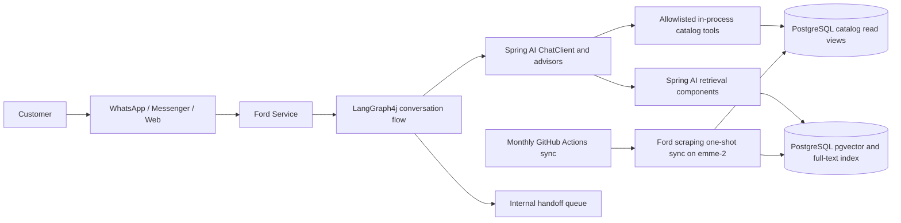

# Ford Service architecture

## Current catalog and assistant path

Ford Service owns the customer conversation. LangGraph4j coordinates the conversation flow; Spring AI provides model calls, tool registration, and retrieval integration. Catalog facts are read through in-process, allowlisted Spring AI tools backed by PostgreSQL read views. The service database role is read-only for catalog data. It does not call a separate catalog tool server.

The Ford scraping project remains the catalog writer. Its scheduled monthly workflow runs a one-shot sync on emme-2 after verifying the same-day database backup. The crawler updates the existing catalog tables and approved knowledge documents; Spring AI reads them. Catalog synchronization and assistant serving are separate responsibilities over the same database.

## Data and trust boundaries

- PostgreSQL is canonical for conversations, handoffs, outbox state, catalog read views, approved knowledge, and graph checkpoints.
- Redis is a fail-open cache for hot conversation state; it is not canonical.
- The scraper writes catalog data. The service reads catalog facts using a dedicated least-privilege database role.
- Customer text, retrieved documents, model output, and tool output are untrusted input. Deterministic application policy constrains tool access and validates the final response.
- Catalog tools are read-only. Write actions such as handoff remain application-owned and are not exposed as model tools.
- Approved knowledge retrieval uses the Spring AI retrieval path with PostgreSQL vector and full-text candidates. Exact vehicle facts use structured catalog queries.

## Operations

- Local development: use the service's Compose and mise tasks.
- Development Actions workflow: starts the isolated Compose stack and verifies application health.
- Production Service: protected blue-green release to emme-1, with pre-release database backup and health checks.
- Catalog refresh: monthly GitHub Actions workflow invokes the protected Ansible one-shot sync on emme-2 after validating PostgreSQL and Redis backup artifacts.
- Production data services remain on emme-2. The Service uses a dedicated read-only catalog credential and must not run catalog migrations during normal application startup.

The retired remote catalog protocol and its old production resources are not part of the Service release path. Their remote containers, workstation tunnel, and obsolete credentials require a separately verified production cleanup; see the retirement checklist in [`tasks/todo.md`](../../tasks/todo.md).

## Historical material

Dated MCP design and rollout documents elsewhere in `docs/superpowers/` describe earlier architecture and are retained as historical implementation evidence. They are not current deployment instructions.
