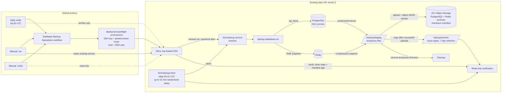

# Database Backups: Operations and Data Flow

This page explains the daily backup on emme-2, the GitHub Actions controls,
where backup files go, and what the current verification has confirmed.

## System overview

The VM systemd timer is the **only automatic backup scheduler**. GitHub's daily
workflow checks timer state and backup freshness; it does not start a scheduled
backup. The manual `run` option intentionally starts the existing service on the
existing VM. No new VM is created.

## What happens during a backup

The [backup script template](../../deployment/ansible/roles/backup/templates/backup-databases.sh.j2)
performs these steps:

1. Dump PostgreSQL and snapshot Redis using the existing Docker Compose data
   services.
2. Compress each archive and create a JSON manifest with UTC creation time,
   archive names, and SHA-256 checksums.
3. Upload the PostgreSQL archive, Redis archive, and manifest to OCI Object
   Storage using the VM's instance principal.
4. Check each uploaded object with OCI Object Storage `head`.
5. Copy the archives and manifest into the local archive directory, then delete
   local files older than seven days.
6. Remove the temporary staging directory when the script exits.

The bucket lifecycle policy controls remote retention. The local seven-day
cleanup and remote bucket retention are separate controls. A successful upload
is not a restore test; restore only into a separate database when testing
recovery.

## GitHub Actions controls

Workflow: [Database Backup Operations](../../.github/workflows/database-backup.yml)

Open **GitHub → Ford-uruapan → Actions → Database Backup Operations → Run
workflow** and choose an operation:

| Operation | Effect | Starts a backup? |
|---|---|---:|
| `run` | Starts `ford-backup.service` on emme-2; checks systemd success and a newly created manifest. | Yes |
| `verify` | Checks the timer is enabled and active, then checks that the newest local manifest is no older than 36 hours. | No |
| Daily schedule | Runs the same timer/freshness checks at 04:30 UTC, after the VM timer's normal window. | No |

The manual `run` check uses the manifest timestamp to ensure the service created
a fresh backup for that invocation. The workflow does not transfer database
archives to GitHub or upload them as workflow artifacts. GitHub receives only
the operation result and manifest timestamp.

### GitHub environment configuration

The workflow uses the existing `deployment-preflight` environment:

| GitHub setting | Name | Purpose |
|---|---|---|
| Secret | `DATA_SSH_PRIVATE_KEY` | SSH authentication to emme-2 |
| Secret | `DATA_SSH_KNOWN_HOSTS` | Pinned SSH host key; host key scanning is not used |
| Variable | `DATA_SSH_HOST` | emme-2 SSH host |
| Variable | `OCI_SSH_USER` | SSH account |

SSH enforces strict host-key checking. Temporary key files are permissioned
restrictively and removed at the end of each Actions job. Secret values do not
belong in workflow logs or this document.

## Current status and first successful run

On 2026-10-14, the `verify` action reached emme-2 successfully. The checks for
the timer being enabled and active passed. Verification then failed because the
expected local archive directory `/opt/ford/backup/archive` did not exist, so
there was no manifest to check. This means **GitHub Actions is connected, but a
successful backup has not yet been confirmed**. The failed read-only run is
[here](https://github.com/migangdelzar/Ford-uruapan/actions/runs/38624012384).

To establish the first backup:

1. In Actions, choose **Database Backup Operations → Run workflow**.
2. Select `run` and start the workflow on `main`.
3. Confirm the workflow reports a successful systemd result and a newly created
   manifest timestamp.
4. Run it again with `verify`; confirm the timer is active and the manifest is
   fresh.

The `run` option changes backup state by creating archives and uploading them
to OCI Object Storage. It has not been run as part of adding these GitHub
Actions controls. Until a successful manifest exists, the scheduled GitHub
verification will correctly report a failure.

## Related implementation

- [GitHub Actions workflow](../../.github/workflows/database-backup.yml)
- [systemd timer template](../../deployment/ansible/roles/backup/templates/ford-backup.timer.j2)
- [systemd service template](../../deployment/ansible/roles/backup/templates/ford-backup.service.j2)
- [backup script template](../../deployment/ansible/roles/backup/templates/backup-databases.sh.j2)
- [Ansible backup role](../../deployment/ansible/roles/backup/tasks/main.yml)
