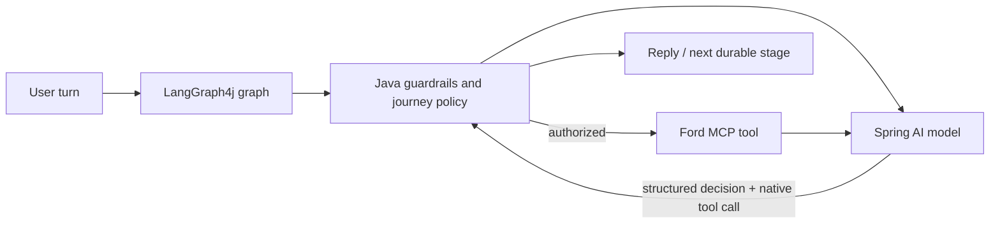

# Conversation Semantic Memory Implementation Plan

> **For agentic workers:** REQUIRED SUB-SKILL: Use superpowers:subagent-driven-development (recommended) or superpowers:executing-plans to implement this plan task-by-task. Steps use checkbox (`- [ ]`) syntax for tracking.

**Goal:** Add bounded, tenant-isolated semantic recall for archived conversation turns using PostgreSQL/pgvector while preserving Redis as hot structured memory and Ford MCP as a separate knowledge system.

**Architecture:** PostgreSQL remains the durable transcript and semantic-memory store. Inbound and outbound turns are indexed asynchronously through Spring Modulith/outbox events. The turn service retrieves at most three relevant historical turns only when the recall policy allows it, while Redis keeps the current summary, facts, and recent window for 24 hours.

**Tech Stack:** Spring Boot, Spring AI `EmbeddingModel`, LangGraph4j, PostgreSQL 16 + pgvector, Spring JDBC `JdbcClient`, Redis, Liquibase, Spring Modulith, JUnit 5, AssertJ, Mockito, Testcontainers.

## Global Constraints

- PostgreSQL is the durable source of truth; Redis is fail-open cache only.
- Redis hot-memory TTL is 24 hours; working-memory expiry is 90 days.
- The current embedding contract is 1536 dimensions; model changes require versioned reindexing.
- Semantic recall returns at most three turns and never crosses tenant, channel, provider-account, participant, or conversation scope.
- Semantic indexing is asynchronous and cannot delay webhook acknowledgement or bot response delivery.
- Ford MCP remains the owner of Ford catalog/RAG knowledge and is not used for conversation-memory indexing.
- The full transcript is never sent to the model; the existing eight-message prompt window remains.
- Semantic retrieval remains disabled by default until quality and isolation tests pass.
- No Redis Stack dependency is introduced in this implementation.

## Cognitive control policy

The system does not add a second autonomous “reasoning agent.” The existing
cloud chat model is the reasoning model, LangGraph4j owns orchestration, and
Java policies remain the deterministic authority for safety, scope, handoff,
tool authorization, and stage transitions.



| Pattern | Production policy | Reason |
|---|---|---|
| Native tool calling | Default for every live turn | Structured, fast, and compatible with MCP |
| Plan-and-Execute | Use for the known sales journey: discovery → offers → financing/trade-in → appointment | LangGraph persists the stage and prevents unnecessary backtracking |
| ReAct | Bounded recovery only: one tool correction/retry after a bad or incomplete result | Preserves adaptability without open-ended loops |
| ReWOO | Background batch work only, such as independent enrichment or indexing jobs | Live MCP dependencies are not predictable enough for the primary chat path |
| Reflexion | Prefer deterministic Java validation; allow at most one structured repair when enabled | A second full response call is expensive and must respect the two-call budget |
| Tree of Thoughts | Not enabled for customer chat | Excessive cost, latency, and difficult operational behavior |

The model may propose an intent, tool call, lead action, or next stage. The
graph validates it against the current durable stage, authorized tool family,
tenant scope, human-handoff policy, and model-call budget. Invalid proposals
are rejected or repaired; the model cannot directly mutate conversation state.

The live-turn budget is:

- one primary model call;
- one approved fallback or structured repair call, never both;
- at most two attempts per MCP tool;
- at most three graph rounds for one inbound turn;
- no unbounded ReAct loop;
- no full chain-of-thought persistence. Persist only structured decisions,
  stage, action, summary, and operational observations.

This means the “agent that reasons” is the configured Spring AI chat model,
while LangGraph4j is the process owner and Java is the policy owner. The
conversation-memory vector search is context retrieval, not an independent
reasoning agent.

## File map

- `src/main/resources/db/changelog/changes/017-conversation-memory-embeddings.yaml`: pgvector table and indexes.
- `src/main/java/com/ford/service/conversations/domain/ConversationMemoryRecall.java`: recalled-turn value.
- `src/main/java/com/ford/service/conversations/application/ConversationMemoryRecallPort.java`: semantic boundary.
- `src/main/java/com/ford/service/conversations/application/ConversationMemoryRecallPolicy.java`: recall decision and bounds.
- `src/main/java/com/ford/service/conversations/application/ConversationMemoryIndexRequested.java`: async indexing event.
- `src/main/java/com/ford/service/conversations/application/ConversationMemoryRecallService.java`: redaction, embeddings, recall, fail-open behavior.
- `src/main/java/com/ford/service/conversations/adapter/out/PgVectorConversationMemoryRecallAdapter.java`: `JdbcClient` pgvector adapter.
- Existing `ConversationMemoryService`, workflow, prompt adapter, configuration, YAML, and tests: integration points.

---

### Task 1: Add the durable pgvector schema

**Files:**
- Create: `ford-ai-service/src/main/resources/db/changelog/changes/017-conversation-memory-embeddings.yaml`
- Modify: `ford-ai-service/src/main/resources/db/changelog/db.changelog-master.yaml`
- Test: `ford-ai-service/src/integrationTest/java/com/ford/service/database/SchemaIntegrationTest.java`

**Produces:** `conversation_memory_embedding` with tenant/conversation scope,
source message identity, redacted text, model version, `vector(1536)`,
timestamps, active status, a uniqueness constraint, a B-tree scope index, and
an HNSW cosine index. Rollback drops only this new table.

- [ ] **Step 1: Write failing schema assertions**

```java
assertThat(tableExists(connection, "conversation_memory_embedding")).isTrue();
assertThat(columnExists(connection, "conversation_memory_embedding", "embedding")).isTrue();
assertThat(indexExists(connection, "idx_conversation_memory_embedding_scope")).isTrue();
assertThat(indexExists(connection, "idx_conversation_memory_embedding_hnsw")).isTrue();
```

- [ ] **Step 2: Run the test and verify failure**

```bash
./gradlew integrationTest --tests com.ford.service.database.SchemaIntegrationTest
```

Expected: FAIL because the table and indexes are absent.

- [ ] **Step 3: Add and include the Liquibase change set**

Use the existing YAML change-set conventions. Include columns for
`tenant_id`, `conversation_id`, `channel`, `provider_account_id`,
`participant_id`, `source_message_id`, `direction`, `content_redacted`,
`embedding_model`, `embedding vector(1536)`, `occurred_at`, `active`,
`created_at`, and `updated_at`. Add uniqueness on
`conversation_id, source_message_id, embedding_model`.

- [ ] **Step 4: Run the schema test and commit**

```bash
./gradlew integrationTest --tests com.ford.service.database.SchemaIntegrationTest
git add ford-ai-service/src/main/resources/db/changelog ford-ai-service/src/integrationTest/java/com/ford/service/database/SchemaIntegrationTest.java
git commit -m "feat(memory): add conversation embedding schema"
```

Expected: migration and assertions pass.

### Task 2: Define the recall value, port, and policy

**Files:**
- Create: `ford-ai-service/src/main/java/com/ford/service/conversations/domain/ConversationMemoryRecall.java`
- Create: `ford-ai-service/src/main/java/com/ford/service/conversations/application/ConversationMemoryRecallPort.java`
- Create: `ford-ai-service/src/main/java/com/ford/service/conversations/application/ConversationMemoryRecallPolicy.java`
- Test: `ford-ai-service/src/test/java/com/ford/service/conversations/ConversationMemoryRecallPolicyTest.java`

**Interfaces:**

```java
public record ConversationMemoryRecall(
        UUID sourceMessageId,
        ConversationMessage.Direction direction,
        String content,
        Instant occurredAt,
        double similarity) {}

public interface ConversationMemoryRecallPort {
    List<ConversationMemoryRecall> search(
            ConversationMemoryKey key, String query, Instant before,
            int limit, double minimumSimilarity);

    void upsert(ConversationMemoryKey key, ConversationMessage message,
                String redactedContent, String embeddingModel, float[] embedding);
}
```

`ConversationMemoryRecallPolicy.shouldRecall(String, ConversationMemoryContext)`
recognizes explicit historical questions and memory-dependent requests. Its
`limit(int)` always returns `min(configuredLimit, 3)`.

- [ ] **Step 1: Write failing tests**

```java
assertThat(policy.shouldRecall("¿Qué presupuesto le había dicho?", context)).isTrue();
assertThat(policy.shouldRecall("¿Qué promociones tienen?", context)).isFalse();
assertThat(policy.limit(10)).isEqualTo(3);
assertThat(policy.limit(2)).isEqualTo(2);
```

- [ ] **Step 2: Run and verify failure**

```bash
./gradlew test --tests com.ford.service.conversations.ConversationMemoryRecallPolicyTest
```

Expected: FAIL because the new types do not exist.

- [ ] **Step 3: Implement and verify**

Normalize null content, reject invalid similarity values, copy collections,
support Spanish and English historical phrases, and cap all limits at three.

```bash
./gradlew test --tests com.ford.service.conversations.ConversationMemoryRecallPolicyTest
```

Expected: PASS.

- [ ] **Step 4: Commit**

```bash
git add ford-ai-service/src/main/java/com/ford/service/conversations/domain/ConversationMemoryRecall.java ford-ai-service/src/main/java/com/ford/service/conversations/application/ConversationMemoryRecallPort.java ford-ai-service/src/main/java/com/ford/service/conversations/application/ConversationMemoryRecallPolicy.java ford-ai-service/src/test/java/com/ford/service/conversations/ConversationMemoryRecallPolicyTest.java
git commit -m "feat(memory): define bounded conversation recall policy"
```

### Task 3: Implement the pgvector adapter

**Files:**
- Create: `ford-ai-service/src/main/java/com/ford/service/conversations/adapter/out/PgVectorConversationMemoryRecallAdapter.java`
- Test: `ford-ai-service/src/test/java/com/ford/service/conversations/PgVectorConversationMemoryRecallAdapterTest.java`

- [ ] **Step 1: Write failing adapter tests**

Use the existing `JdbcClient` test-double style. Assert that search SQL
contains tenant, conversation, channel, provider-account, participant,
`active`, `occurred_at < :before`, cosine ordering, and `limit :limit`. Assert
that upsert SQL uses `ON CONFLICT` and the embedding model identity.

- [ ] **Step 2: Run and verify failure**

```bash
./gradlew test --tests com.ford.service.conversations.PgVectorConversationMemoryRecallAdapterTest
```

Expected: FAIL because the adapter does not exist.

- [ ] **Step 3: Implement scoped search and idempotent upsert**

Use `embedding <=> cast(:embedding as vector)` and return `1 - distance` as
similarity. Keep every scope predicate in SQL. Reuse the existing vector
literal convention and `JdbcClient`; do not introduce another persistence
framework.

- [ ] **Step 4: Run and commit**

```bash
./gradlew test --tests com.ford.service.conversations.PgVectorConversationMemoryRecallAdapterTest
git add ford-ai-service/src/main/java/com/ford/service/conversations/adapter/out/PgVectorConversationMemoryRecallAdapter.java ford-ai-service/src/test/java/com/ford/service/conversations/PgVectorConversationMemoryRecallAdapterTest.java
git commit -m "feat(memory): add pgvector conversation recall adapter"
```

Expected: PASS.

### Task 4: Add asynchronous indexing and fail-open recall service

**Files:**
- Create: `ford-ai-service/src/main/java/com/ford/service/conversations/application/ConversationMemoryIndexRequested.java`
- Create: `ford-ai-service/src/main/java/com/ford/service/conversations/application/ConversationMemoryRecallService.java`
- Modify: `ford-ai-service/src/main/java/com/ford/service/conversations/application/ConversationConfiguration.java`
- Test: `ford-ai-service/src/test/java/com/ford/service/conversations/ConversationMemoryRecallServiceTest.java`

**Interfaces:**

```java
public record ConversationMemoryIndexRequested(
        ConversationMemoryKey key,
        ConversationMessage message) {}

public List<ConversationMemoryRecall> recall(
        ConversationMemoryKey key, String query,
        ConversationMemoryContext context, Instant before);

public void index(ConversationMemoryKey key, ConversationMessage message);
```

- [ ] **Step 1: Write failing service tests**

Test that ordinary queries skip vector search, historical queries return at
most three records, adapter/embedding failures return an empty list, and
redaction removes configured email, phone, and token patterns before indexing.

- [ ] **Step 2: Run and verify failure**

```bash
./gradlew test --tests com.ford.service.conversations.ConversationMemoryRecallServiceTest
```

Expected: FAIL because the service does not exist.

- [ ] **Step 3: Implement service and listener**

Inject the port, policy, `EmbeddingModel`, and configuration. Use the model
version in every upsert. Do not log raw messages, vectors, credentials, or
personal data. Handle `ConversationMemoryIndexRequested` with
`@ApplicationModuleListener`; let existing outbox retry infrastructure handle
transient failures.

- [ ] **Step 4: Run and commit**

```bash
./gradlew test --tests com.ford.service.conversations.ConversationMemoryRecallServiceTest
git add ford-ai-service/src/main/java/com/ford/service/conversations/application/ConversationMemoryIndexRequested.java ford-ai-service/src/main/java/com/ford/service/conversations/application/ConversationMemoryRecallService.java ford-ai-service/src/main/java/com/ford/service/conversations/application/ConversationConfiguration.java ford-ai-service/src/test/java/com/ford/service/conversations/ConversationMemoryRecallServiceTest.java
git commit -m "feat(memory): index conversation turns asynchronously"
```

Expected: PASS.

### Task 5: Integrate recall and indexing into both turn workflows

**Files:**
- Modify: `ford-ai-service/src/main/java/com/ford/service/conversations/application/ConversationMemoryService.java`
- Modify: `ford-ai-service/src/main/java/com/ford/service/conversations/application/ConversationAssistantAdapter.java`
- Modify: `ford-ai-service/src/main/java/com/ford/service/conversations/application/ConversationWorkflow.java`
- Modify: `ford-ai-service/src/main/java/com/ford/service/conversations/application/ConversationTurnCommitService.java`
- Modify: `ford-ai-service/src/main/java/com/ford/service/conversations/application/MemoryProperties.java`
- Modify: `ford-ai-service/src/main/resources/application.yml`
- Modify: `ford-ai-service/.env.example` and `ford-ai-service/.env.prod.example`
- Test: `ford-ai-service/src/test/java/com/ford/service/conversations/ConversationMemoryServiceTest.java`
- Test: `ford-ai-service/src/test/java/com/ford/service/ai/ConversationAssistantAdapterTest.java`
- Test: `ford-ai-service/src/test/java/com/ford/service/conversations/ConversationWorkflowTest.java`

- [ ] **Step 1: Write failing integration tests**

Assert that historical queries render a `[RECUERDOS RELEVANTES]` section,
ordinary queries omit it, recalled text is capped at three turns, and both
legacy and graph workflows publish indexing events after inbound/outbound
transcript persistence.

- [ ] **Step 2: Run and verify failure**

```bash
./gradlew test --tests com.ford.service.conversations.ConversationMemoryServiceTest --tests com.ford.service.ai.ConversationAssistantAdapterTest --tests com.ford.service.conversations.ConversationWorkflowTest
```

Expected: FAIL because recall and indexing events are not integrated.

- [ ] **Step 3: Implement bounded context integration**

When `FORD_MEMORY_SEMANTIC_ENABLED=false`, preserve current behavior exactly.
When enabled, invoke the policy, deduplicate by source message, discard weak
similarities, and cap results at three. Render recalled text as historical
untrusted context outside the current-message block.

- [ ] **Step 4: Publish events from both workflows**

Publish after canonical inbound/outbound persistence succeeds. Do not publish
for ignored turns, handoff-only turns, or failed optimistic version updates.

- [ ] **Step 5: Add configuration and verify**

```yaml
semantic-enabled: ${FORD_MEMORY_SEMANTIC_ENABLED:false}
semantic-limit: ${FORD_MEMORY_SEMANTIC_LIMIT:3}
semantic-minimum-similarity: ${FORD_MEMORY_SEMANTIC_MINIMUM_SIMILARITY:0.78}
embedding-model-version: ${FORD_AI_EMBEDDING_MODEL_VERSION:configured-embedding-model}
```

Reject semantic limits above three and similarity thresholds outside `[0, 1]`.

```bash
./gradlew test --tests com.ford.service.conversations.ConversationMemoryServiceTest --tests com.ford.service.ai.ConversationAssistantAdapterTest --tests com.ford.service.conversations.ConversationWorkflowTest
```

Expected: PASS.

- [ ] **Step 6: Commit**

```bash
git add ford-ai-service/src/main/java/com/ford/service/conversations ford-ai-service/src/main/resources/application.yml ford-ai-service/.env.example ford-ai-service/.env.prod.example ford-ai-service/src/test/java/com/ford/service/conversations ford-ai-service/src/test/java/com/ford/service/ai/ConversationAssistantAdapterTest.java
git commit -m "feat(memory): add bounded semantic recall to turns"
```

### Task 6: Enforce cognitive-pattern policy in the graph

**Files:**
- Modify: `ford-ai-service/src/main/java/com/ford/service/conversations/application/graph/ConversationGraphRunner.java`
- Modify: `ford-ai-service/src/main/java/com/ford/service/conversations/application/ConversationTurnProcessor.java`
- Modify: `ford-ai-service/src/main/java/com/ford/service/conversations/application/ConversationWorkflow.java`
- Modify: `ford-ai-service/src/main/java/com/ford/service/conversations/application/ConversationTurnCommitService.java`
- Modify: `ford-ai-service/src/main/java/com/ford/service/ai/application/DecisionPolicy.java`
- Create: `ford-ai-service/src/main/java/com/ford/service/conversations/application/ConversationCognitivePolicy.java`
- Test: `ford-ai-service/src/test/java/com/ford/service/conversations/ConversationCognitivePolicyTest.java`
- Test: `ford-ai-service/src/test/java/com/ford/service/conversations/ConversationGraphRunnerTest.java`

**Interfaces:**

```java
public interface ConversationCognitivePolicy {
    CognitivePattern patternFor(ConversationTurnInput input);
    boolean mayAdvance(ConversationStage current, ConversationStage proposed);
    boolean mayRetryTool(int attempts, ToolFailureCategory failure);
    boolean mayRepair(int modelCalls);
}
```

The initial implementation returns native tool calling for ordinary turns,
Plan-and-Execute for known journey stages, ReAct recovery only for retryable
tool failures, and rejects Tree of Thoughts. It must not expose hidden model
reasoning or persist chain-of-thought.

- [ ] **Step 1: Write failing cognitive-policy tests**

Cover these invariants:

```java
assertThat(policy.patternFor(ordinaryTurn())).isEqualTo(NATIVE_TOOL_CALLING);
assertThat(policy.patternFor(knownSalesJourneyTurn())).isEqualTo(PLAN_AND_EXECUTE);
assertThat(policy.patternFor(retryableMcpFailure())).isEqualTo(BOUNDED_REACT_RECOVERY);
assertThat(policy.mayRetryTool(2, TIMEOUT)).isFalse();
assertThat(policy.mayRepair(2)).isFalse();
```

- [ ] **Step 2: Run and verify failure**

```bash
./gradlew test --tests com.ford.service.conversations.ConversationCognitivePolicyTest
```

Expected: FAIL because the cognitive policy does not exist.

- [ ] **Step 3: Implement the bounded policy and graph integration**

Keep stage transitions and tool authorization in Java. Let the model return
structured proposals only. Add graph metadata for pattern, stage, round, and
model-call count; do not store private chain-of-thought. Route retryable MCP
failures through one bounded recovery edge and route terminal failures to the
existing safe response/fallback path.

- [ ] **Step 4: Run focused and full tests**

```bash
./gradlew test --tests com.ford.service.conversations.ConversationCognitivePolicyTest --tests com.ford.service.conversations.ConversationGraphRunnerTest
./gradlew test
```

Expected: both commands pass with no unbounded graph loop.

- [ ] **Step 5: Commit**

```bash
git add ford-ai-service/src/main/java/com/ford/service/conversations/application/graph ford-ai-service/src/main/java/com/ford/service/conversations/application/ConversationCognitivePolicy.java ford-ai-service/src/main/java/com/ford/service/ai/application/DecisionPolicy.java ford-ai-service/src/test/java/com/ford/service/conversations/ConversationCognitivePolicyTest.java ford-ai-service/src/test/java/com/ford/service/conversations/ConversationGraphRunnerTest.java
git commit -m "feat(graph): enforce bounded cognitive patterns"
```

### Task 7: Verify database isolation and outbox behavior

**Files:**
- Create: `ford-ai-service/src/integrationTest/java/com/ford/service/e2e/ConversationSemanticMemoryIsolationIntegrationTest.java`

- [ ] **Step 1: Write failing integration tests**

Create two tenants and two conversations with similar messages. Assert that a
search cannot cross tenant or conversation scope and duplicate events produce
one row per source message/model.

- [ ] **Step 2: Run and verify failure**

```bash
./gradlew integrationTest --tests com.ford.service.e2e.ConversationSemanticMemoryIsolationIntegrationTest
```

Expected: FAIL until real Liquibase, adapter, listener, and filters are wired.

- [ ] **Step 3: Implement only fixture wiring required by the test**

Use existing Testcontainers and `JdbcClient` fixtures. Do not add test-only
bypasses for tenant filtering.

- [ ] **Step 4: Run and commit**

```bash
./gradlew integrationTest --tests com.ford.service.e2e.ConversationSemanticMemoryIsolationIntegrationTest
git add ford-ai-service/src/integrationTest/java/com/ford/service/e2e/ConversationSemanticMemoryIsolationIntegrationTest.java
git commit -m "test(memory): verify semantic memory isolation"
```

Expected: PASS.

### Task 8: Document rollout, metrics, and release safety

**Files:**
- Modify: `ford-ai-service/docs/operations.md`
- Modify: `ford-ai-service/README.md`
- Test: full unit and integration suites

- [ ] **Step 1: Document configuration and rollback**

Document the disabled-by-default flag, 1536-dimensional model contract,
backfill-free rollout, pgvector health check, and additive Liquibase rollback.
State that Redis Vector is not enabled and Redis remains structured cache.

- [ ] **Step 2: Add bounded metrics**

Add counters/timers for recall attempts, hits, misses, failures, indexing
success/failure, result count, and latency. Never use message text, vectors,
tokens, or personal data as metric tags.

- [ ] **Step 3: Run final verification**

```bash
./gradlew test
./gradlew integrationTest
git diff --check
```

Expected: all tests pass, no skipped isolation tests, and no whitespace errors.

- [ ] **Step 4: Commit**

```bash
git add ford-ai-service/docs/operations.md ford-ai-service/README.md
git commit -m "docs(memory): document semantic recall rollout"
```

## Self-review

- Schema, memory policy, adapter, async indexing, context integration,
  cognitive policy, isolation, and operations are covered by Tasks 1–8.
- Ford MCP remains outside the conversation-memory path.
- Redis Vector is explicitly deferred; no hidden Redis Stack dependency exists.
- All retrieval is bounded by three results and complete scope predicates.
- Embedding dimension and model version are explicit.
- The model proposes actions; LangGraph4j orchestrates; Java policies authorize.
- ReAct recovery, repair, tool attempts, model calls, and graph rounds are bounded.
- Every implementation task starts with a failing test and ends with a focused commit.
