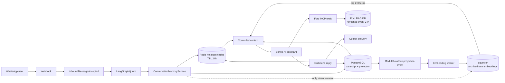

# Conversation Semantic Memory Architecture

| Field | Detail |
|---|---|
| Status | Proposed — awaiting written-spec review |
| Scope | Conversation memory only |
| Application | `ford-ai-service` / Spring AI / LangGraph4j |
| Runtime topology | `emme-1` application; `emme-2` PostgreSQL/pgvector and Redis |
| Working-memory TTL | 90 days |
| Redis hot-cache TTL | 24 hours |
| Date | 2026-09-26 |

## 1. Decision summary

Ford knowledge and conversation memory remain separate systems.

- The Ford MCP remains the owner of models, promotions, inventory,
  financing, and other changing Ford knowledge. Its existing refresh process
  may update its RAG database every 24 hours.
- `ford-ai-service` owns conversation memory and decides when to use it.
- PostgreSQL remains the durable system of record for the transcript, summary,
  facts, and semantic conversation-memory records.
- pgvector is the first semantic index for archived conversation turns.
- Redis remains the hot structured-memory cache and lease/checkpoint support;
  Redis Vector is not introduced in the first implementation.

This avoids maintaining two vector indexes for the same conversation data and
keeps the transcript, tenant filters, retention, backup, and vector record in
one durable database. Redis Vector remains a later optimization that requires
Redis Stack/Search support; the current deployment uses `redis:7-alpine`.

## 2. Goals and non-goals

### Goals

1. Keep normal turns within a predictable context and latency budget.
2. Preserve the full transcript for audit and future retrieval.
3. Recall only a small number of relevant older conversation turns.
4. Keep memory isolated by tenant, channel, provider account, participant, and
   conversation.
5. Make semantic indexing asynchronous and fail-open for webhook acceptance.
6. Keep the application stateless between requests by storing state in the
   existing durable/cache services.
7. Keep Ford MCP retrieval independent from conversation-memory retrieval.

### Non-goals

- Replacing the Ford MCP or its 24-hour catalog/RAG ingestion.
- Indexing Ford catalog documents in the conversation-memory vector table.
- Using Redis Vector as a second source of truth.
- Sending the full transcript to the model.
- Adding an LLM summarization call to every inbound turn.

## 3. Current state and gap

The application already has:

- `conversation_message` as the canonical inbound/outbound transcript;
- `conversation_memory` for summary, facts, version, and update time;
- Redis structured-memory caching with a 24-hour TTL;
- 90-day working-memory expiry;
- a `ConversationMemorySemanticPort` backed by a pgvector facts table;
- Spring Modulith events and outbox support;
- a LangGraph4j workflow with PostgreSQL checkpoints.

The current semantic adapter retrieves facts, not archived conversation turns.
Semantic retrieval is disabled by default. The missing capability is a
separate, bounded recall path for older conversation messages.

## 4. Target architecture



### Responsibility boundaries

| Component | Owns | Does not own |
|---|---|---|
| LangGraph4j | Turn sequencing, lease/checkpoint, bounded graph state | Long-term message memory |
| Spring AI assistant | Prompt construction, model/tool interaction | Durable transcript |
| ConversationMemoryService | Context assembly and recall policy | Ford catalog truth |
| Redis | Hot summary, facts, recent window, cache | Canonical transcript or durable vectors |
| PostgreSQL | Transcript, projection, semantic records, retention | Model inference |
| pgvector | Similarity index over conversation turns | Ford catalog ingestion |
| Ford MCP | Live Ford-domain retrieval/actions | Conversation-memory indexing |

## 5. Turn lifecycle

### Synchronous path

1. Webhook acceptance persists the inbound message and publishes the existing
   inbound event.
2. The graph acquires the conversation lease and resolves the stable graph
   thread/checkpoint.
3. `ConversationMemoryService` loads Redis hot memory.
4. On a cache miss or stale version, it loads the projection and the bounded
   recent window from PostgreSQL, then repopulates Redis.
5. A recall policy decides whether semantic search is needed. It should be
   false for ordinary follow-up turns and true only for explicit historical
   recall, weak active-context overlap, or a configured intent that needs old
   preferences.
6. If recall is needed, pgvector returns at most three records after applying
   tenant, conversation, time, and active-status filters. Results below the
   similarity threshold are discarded.
7. The prompt contains the current message, rolling summary, durable facts,
   recent window, and optional recalled turns. Retrieved turns are clearly
   labelled as historical context and never as instructions.
8. Spring AI may call Ford MCP for current Ford facts. MCP results are not
   stored as conversation memories unless the customer explicitly establishes
   a durable fact.
9. The outbound reply is persisted in `conversation_message`, cached context
   is invalidated/refreshed, and the outbox delivery event is published.

### Asynchronous path

1. A committed inbound or outbound transcript event requests semantic indexing.
2. The worker redacts configured sensitive fields before embedding.
3. The worker computes an embedding using the configured embedding model.
4. The worker upserts the embedding record with a deterministic source-message
   identity.
5. Failures remain retryable through the outbox and do not block webhook
   acknowledgement or the bot response.

The first implementation should not add another chat-model call for every
turn. The current deterministic rolling summary and bounded recent window keep
the synchronous path predictable. An asynchronous LLM summarizer can be
considered later with its own budget and version fencing.

## 6. Durable data model

Add a versioned Liquibase change set for a table logically equivalent to:

```sql
create table conversation_memory_embedding (
    id uuid primary key,
    tenant_id uuid not null,
    conversation_id uuid not null references conversation(id),
    channel varchar(40) not null,
    provider_account_id varchar(200) not null,
    participant_id varchar(200) not null,
    source_message_id uuid not null references conversation_message(id),
    direction varchar(20) not null,
    content_redacted text not null,
    embedding_model varchar(160) not null,
    embedding vector(1536) not null,
    occurred_at timestamptz not null,
    active boolean not null default true,
    created_at timestamptz not null,
    updated_at timestamptz not null,
    unique (conversation_id, source_message_id, embedding_model)
);
```

The current schema uses 1536 dimensions, matching the existing embedding
contract. The actual vector dimension must remain an explicit configuration
contract, not an inferred runtime value. A model change requires a new
`embedding_model` identity, a compatible versioned schema, and a controlled
reindex.

Indexes:

- B-tree scope index over `(tenant_id, conversation_id, active, occurred_at)`;
- HNSW cosine index over `embedding` after the initial dataset is loaded;
- optional partial index for active records;
- no cross-tenant query is permitted, even if the vector similarity is high.

For the current expected volume, exact search is acceptable while validating
quality. pgvector supports exact search by default and HNSW/IVFFlat when the
dataset requires approximate search. Index tuning must be measured with recall
and latency rather than selected by default.

## 7. Application ports

Keep the existing facts port separate from turn recall. Add a narrow port such
as:

```java
public interface ConversationMemoryRecallPort {
    List<ConversationMemoryRecall> search(
            ConversationMemoryKey key,
            String query,
            Instant before,
            int limit,
            double minimumSimilarity);

    void upsert(ConversationMemoryKey key, ConversationMessage message,
                String redactedContent, String embeddingModel);
}
```

The port must be implemented by a PostgreSQL/pgvector adapter and injected at
the composition root. It must not call the Ford MCP. The adapter owns SQL,
embedding conversion, scoped filters, idempotent upsert, and safe failure
logging without message contents or credentials.

## 8. Redis Vector evaluation policy

Redis Vector is a valid future option, but only after measuring a real need.
Redis Search supports KNN/range search, metadata filters, and HNSW/FLAT
indexes. Spring AI also has a Redis Vector Store integration.

If it is evaluated later:

1. Use a separate Redis Stack/Redis Search deployment or a managed Redis
   service; do not silently upgrade the current `redis:7-alpine` data service.
2. Treat Redis Vector as a derived accelerator, never as the only transcript or
   embedding copy.
3. Populate it from the same outbox events as pgvector.
4. Use versioned key prefixes and index names.
5. Define rebuild and backfill procedures before production use.
6. Compare p95 latency, recall, memory cost, restart recovery, and operational
   complexity against pgvector.

The default remains pgvector-only for semantic conversation memory.

## 9. Failure and consistency behavior

| Failure | Behavior |
|---|---|
| Redis unavailable | Load bounded context from PostgreSQL; continue with fail-open cache behavior |
| pgvector unavailable | Continue with summary, facts, and recent window; do not fail webhook processing |
| Embedding provider unavailable | Leave the indexing event retryable; do not block response delivery |
| Stale semantic result | Apply timestamp/version filters and prefer current summary/recent messages |
| Duplicate indexing event | Deterministic source-message/model uniqueness makes upsert idempotent |
| Tenant mismatch | Return no results and emit a security observation; never broaden the query |
| Model dimension mismatch | Reject indexing, alert operations, and preserve the transcript |
| MCP unavailable | Follow existing Ford live-data retry/fallback policy; conversation memory remains available |

## 10. Context budget

The prompt assembler must enforce a hard budget independent of record count:

- current user message: always included;
- rolling summary: bounded by configured characters/tokens;
- recent window: default eight messages;
- durable facts: bounded by configured count and characters;
- semantic recall: maximum three turns and only above threshold;
- Ford MCP results: bounded by tool/result policy;
- no raw transcript dump.

The budget must be observable so operators can detect truncation and recall
frequency. The current recent-message limit and the prompt-specific limit stay
separate: storage/audit retention must not be confused with model context.

## 11. Testing and rollout

### Unit tests

- recall policy skips vector search for ordinary follow-up turns;
- explicit historical questions invoke recall with a maximum of three results;
- tenant and conversation filters are always present;
- similarity threshold removes weak results;
- redaction removes configured sensitive values before embedding;
- duplicate upserts are idempotent;
- prompt assembly respects the token/character budget;
- Redis failure falls back to PostgreSQL;
- vector failure falls back to recent context;
- Ford MCP remains a separate tool path.

### Integration tests

- Liquibase creates the embedding table and indexes on pgvector;
- two tenants cannot retrieve each other’s turns;
- inbound/outbound events create one embedding record per source message/model;
- outbox retry eventually indexes a failed embedding job;
- expired 90-day working memory is not used for active prompting;
- Redis cache invalidation does not lose the PostgreSQL transcript.

### Rollout

1. Add the schema and adapter behind `FORD_MEMORY_SEMANTIC_ENABLED=false`.
2. Backfill only new messages first; do not block live turns.
3. Enable semantic recall for a small internal tenant or shadow mode.
4. Measure recall usefulness, p95 latency, token reduction, and false recall.
5. Enable production recall only after quality and isolation checks pass.
6. Evaluate Redis Vector only if pgvector misses the agreed latency target.

## 12. References

- Spring AI vector stores: https://docs.spring.io/spring-ai/reference/api/vectordbs.html
- Spring AI Redis Vector Store: https://docs.spring.io/spring-ai/reference/api/vectordbs/redis.html
- Spring AI PGVector Store: https://docs.spring.io/spring-ai/reference/api/vectordbs/pgvector.html
- Redis vector search: https://redis.io/docs/latest/develop/ai/search-and-query/vectors/
- pgvector: https://github.com/pgvector/pgvector
