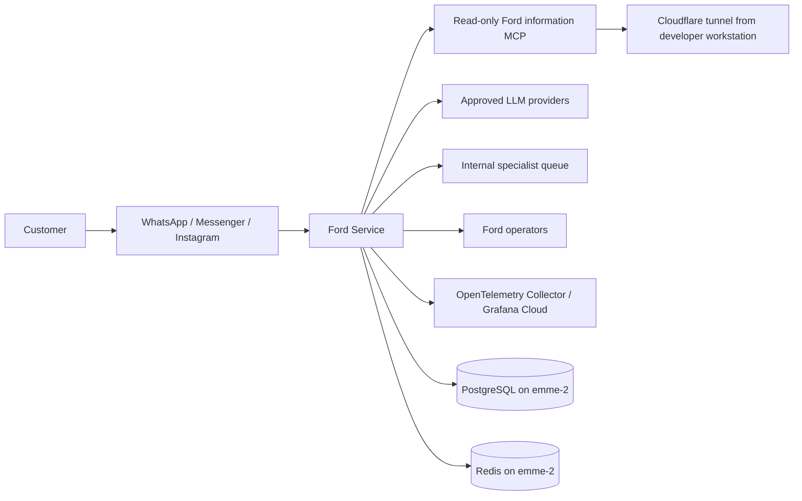
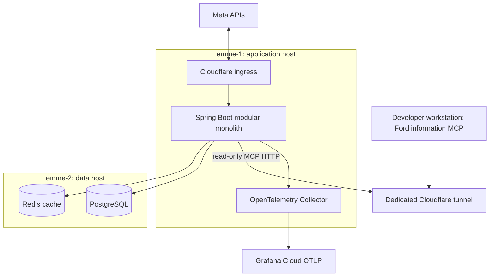
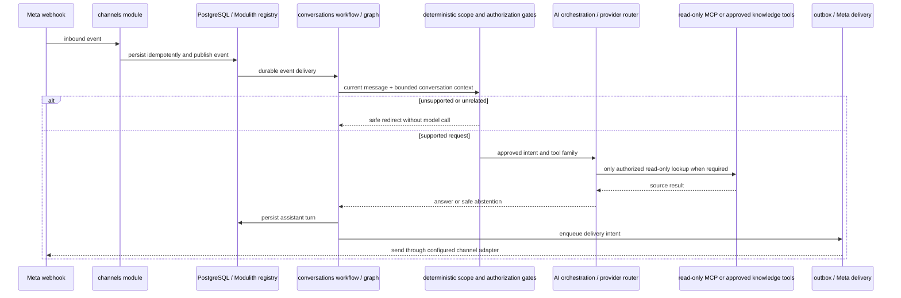

# Ford Service Enterprise Architecture and AI Scope Guardrails

**Status:** Approved design
**Date:** 2026-10-07

## Goal

Establish a current, reviewable enterprise architecture baseline for Ford Service and prevent unsupported or unrelated customer requests from reaching model generation. Preserve the existing modular monolith, integrations, and deployment topology.

## Current state and evidence

The repository contains Spring Boot application code under `ford-ai-service/`, Terraform and Ansible deployment definitions under `deployment/`, and multiple earlier design documents. The approved September 25 conversation-runtime design says implementation has not started and human handoff is disabled; those statements no longer match the application. Treat this document and the linked current-state architecture artifact as the current view, while retaining older documents as historical decision records.

The application is a Spring Boot modular monolith. Spring Modulith persists asynchronous event publications in PostgreSQL; the conversation workflow uses LangGraph4j; Spring AI integrates model providers and tools. PostgreSQL is the source of truth for conversations and operational records. Redis is a cache. The Ford information MCP is a separate read-only provider. The existing internal handoff queue is not a real external CRM/advisor transfer.

The deployed topology observed on 2026-10-07 is one application container on `emme-1`, PostgreSQL and Redis on `emme-2`, an OpenTelemetry Collector beside the application, and the Ford information MCP hosted on the developer workstation and reached through its Cloudflare tunnel. The workstation and tunnel are therefore runtime dependencies for volatile Ford information. Terraform manages infrastructure declaratively; Mise and Ansible are the supported configuration and deployment path.

The Collector was healthy, but its Prometheus scrape of `/actuator/prometheus` returned HTTP 401 every 30 seconds. `FORD_OTEL_TRACES_EXPORT_ENABLED` was absent, so trace export defaulted off. The application had provider diagnostics and Meta diagnostic stack traces enabled. Collector configuration is set to receive and forward Docker logs, but ingestion in Grafana Cloud and dashboard/alert provisioning were not verified. These are explicit operational gaps, not assumed capabilities.

## Enterprise architecture views

### Business and system context

Ford Service supports Ford Uruapan customer conversations over Meta channels, vehicle and offer information, approved dealership knowledge, and internal specialist queue requests. The assistant must decline or redirect unrelated requests and Ford requests it cannot safely support. A model response is not authority to create a handoff, schedule an appointment, mutate CRM data, or claim an external action.

### Application and deployment containers

The application container is the current deployable unit. The module layout is internal and enforced by Spring Modulith; no service split is part of this design. Terraform does not currently own the existing instances in full; Ansible configures them and Mise wraps validation, secret propagation, and deployment.

### Module and request flow

The main modules include `channels`, `conversations`, `ai`, `catalog`, `finance`, `offers`, `knowledge`, `dealership`, `handoff`, `outbox`, `operator`, `events`, `observability`, and supporting modules. Cross-module calls use module APIs and published events; external providers remain behind Spring AI or application ports/adapters.

## Target AI guardrail contract

1. The application makes the scope decision before invoking any chat model.
2. Supported Ford intents may proceed: catalog/details, availability, offers/promotions, financing, approved dealership facts, direct specialist requests, and relevant conversation follow-ups. Other Ford service topics proceed only when a configured, approved knowledge/tool capability supports them; otherwise the app redirects without asking a model to invent an answer.
3. Pure greetings may proceed. A `GENERAL` model classification cannot turn an unrelated request into an allowed request. A follow-up without Ford keywords is allowed only when it has clear follow-up form and the bounded conversation context identifies an active Ford topic.
4. Explicit out-of-scope intent is a hard deny even if the message also contains a Ford name or vehicle term. Mixed requests are not permission to answer the unrelated part.
5. The model classifier may narrow or refine a deterministic allowed request. It cannot expand the deterministic scope. Prompt text is guidance; application code owns enforcement.
6. After scope passes, existing tool allowlists, tenant context, one-attempt-per-tool behavior, read-only MCP permissions, source grounding for volatile facts, provider allowlists, and handoff consent rules remain independently enforced.
7. A blocked request receives a concise Spanish redirect to supported Ford assistance. It does not invoke an LLM, information tool, or handoff capability.

## Quality attributes and architecture principles

- **Security:** deny by default; tenant-scoped tool context; read-only information MCP; isolated handoff queue; secrets in the existing Mise/Ansible secret flow; no raw prompts or provider credentials in logs.
- **Reliability:** PostgreSQL is authoritative; durable Modulith publications and business outbox remain distinct; idempotency and bounded retries remain at their existing boundaries; Redis remains fail-open cache.
- **Model independence:** each provider remains behind the existing routing/adapter boundary; only explicitly configured and capability-gated providers can be called.
- **Grounding:** live prices, availability, offers, and specifications require their source tools; unsupported or unavailable data causes an abstention.
- **Privacy:** telemetry must use bounded dimensions and avoid customer content. Collector logs, metrics, and traces require separate redaction review.
- **Operations:** deploy through Mise/Ansible; use Terraform only for explicitly managed infrastructure changes; never reset production data as an observability or guardrail fix.

## Alternatives considered

1. **Keep prompt-only scope rules.** Rejected because prompts do not enforce authorization and the current `GENERAL` route can reach model generation.
2. **Split the app into microservices.** Rejected because no scale or isolation evidence requires it; it would add network, deployment, and data consistency failure modes without closing the scope gap.
3. **Use model classification as the scope authority.** Rejected because a model may misclassify, follow prompt injection, or broaden access. It may only refine requests already allowed by deterministic application policy.

## Risks and known gaps

- The current lexical `AssistantScopePolicy` allows many `GENERAL` requests and its unrelated-term check is suppressed when Ford context is present.
- The current Prometheus collector scrape receives HTTP 401; metric export is therefore incomplete.
- Trace export is disabled in the observed app environment.
- Grafana Cloud ingestion, dashboard provisioning, and alert rules have not been verified.
- The production MCP depends on a developer workstation and its tunnel being online.
- Older architecture specifications contain stale status statements and should link to this current baseline rather than be silently rewritten as if they described today.

## Acceptance criteria

- The architecture artifact describes business scope, system context, containers/deployment, module boundaries, data ownership, trust boundaries, request flow, operations, and known gaps.
- Scope tests prove common unrelated requests, explicit prompt injection, and mixed Ford/unrelated requests are rejected before model or tool invocation.
- Scope tests prove Ford-domain requests, pure greetings, and clear Ford-context follow-ups remain supported.
- A model-provided in-scope classification cannot override an out-of-scope deterministic result.
- Unsupported dealership/service requests without an approved source are redirected before model generation.
- Existing handoff consent, tenant isolation, read-only MCP allowlists, and source-grounding tests remain unchanged and pass.
- No production customer message is used for testing; no database reset or CRM mutation is performed.

## Out of scope

- Replacing Spring Modulith, Spring AI, LangGraph4j, PostgreSQL, Redis, Terraform, Ansible, or Mise.
- Splitting the modular monolith into services or adding a message broker.
- Enabling unbounded general-purpose question answering or unrestricted agent behavior.
- Changing the real CRM/advisor integration contract or claiming that the internal queue contacts an advisor.
- Fixing the separately identified Prometheus authentication/tracing/Grafana provisioning gaps in this guardrail change. They remain tracked operational work.
