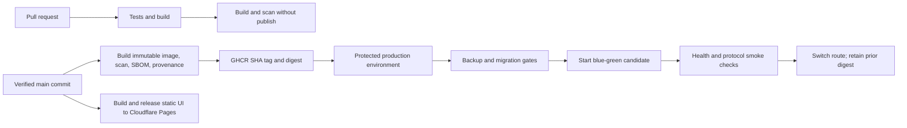

# End-to-end container delivery design

**Status:** Approved direction, implementation in progress
**Date:** 2026-10-13

## Goal

Build, scan, publish, and safely release every OCI-hosted Ford application from GitHub Actions. Keep the static Ford-web UI on Cloudflare Pages.

## Runtime inventory

| Runtime | Artifact | Runtime and release behavior |
|---|---|---|
| Ford Service | `ghcr.io/migangdelzar/ford-uruapan` | Java API container on the existing app VM. Existing backup, Liquibase, blue-green health, and rollback rules remain in force. |
| Ford catalog scraper | `ghcr.io/migangdelzar/ford-scraping` | One immutable Node image runs as two distinct containers on the existing data VM: `scheduler` (monthly at 12:00 America/Mexico_City) and `mcp-http` (protected `/mcp` endpoint). |
| Ford-web | Cloudflare Pages project `ford-web-ui` | Static assets and Pages Functions continue through the Pages build/release path. Ford Service is the only backend container; Ford-web does not build or publish a separate BFF image. |

## Release flow

Images use full source SHA tags and deploy by digest. Pull requests build and scan without registry writes. Main-branch publication requires successful checks. OCI rollout and rollback stay gated by protected GitHub environments and readiness variables. No image tag such as `latest` is used for a deployment.

The Ford-scraping deployment runs the SQL migration command once from the candidate image before starting either container. It starts and checks the MCP candidate and scheduler before switching the stable MCP route. The MCP Compose service explicitly runs `mcp-http`; the scheduler uses the image's default `scheduler` command. Both share the existing `data_default` network, Postgres schema, and Ollama service; neither creates a VM or host port for the scheduler.

Ford Service keeps its pre-deploy database backup and candidate health checks. Liquibase changes must remain compatible with the old active service during candidate startup. Ford-web's Pages deployment remains Cloudflare-native; backend API and authentication requests reach Ford Service.

## Security and failure handling

- CI has read-only permissions except the main-only image publication job, which receives `packages: write` and attestation permissions only where required.
- Runtime credentials remain in the existing OCI runtime secret path; GitHub passes short-lived GHCR read credentials to deployment.
- A failed image build, scan, migration, candidate health check, or protocol check prevents traffic switching.
- The active and prior immutable digests remain recorded for rollback. Database rollback is not automatic; migrations must be forward-compatible and recovery uses the existing verified backup procedure.
- Production flags and environment approvals remain required. Branch verification does not deploy.
- Ford-web CI verifies the Pages UI and Functions; it does not publish a standalone backend image.

## Acceptance

1. CI builds every OCI image and runs its runtime smoke check without publishing from feature branches.
2. Successful main CI publishes immutable GHCR images, vulnerability reports, SBOMs, and provenance.
3. Ford-scraping MCP starts `mcp-http`, scheduler starts `scheduler`, and scraping migrations complete before either candidate is promoted.
4. Ford Service release keeps its backup, migration-compatibility, health, and rollback gates.
5. Ford-web Pages release remains Cloudflare-native, and Ford Service is the only backend image/runtime.
6. GitHub Actions provide evidence for all build, scan, migration, and post-deploy smoke stages. No production rollout is run as part of branch verification.
