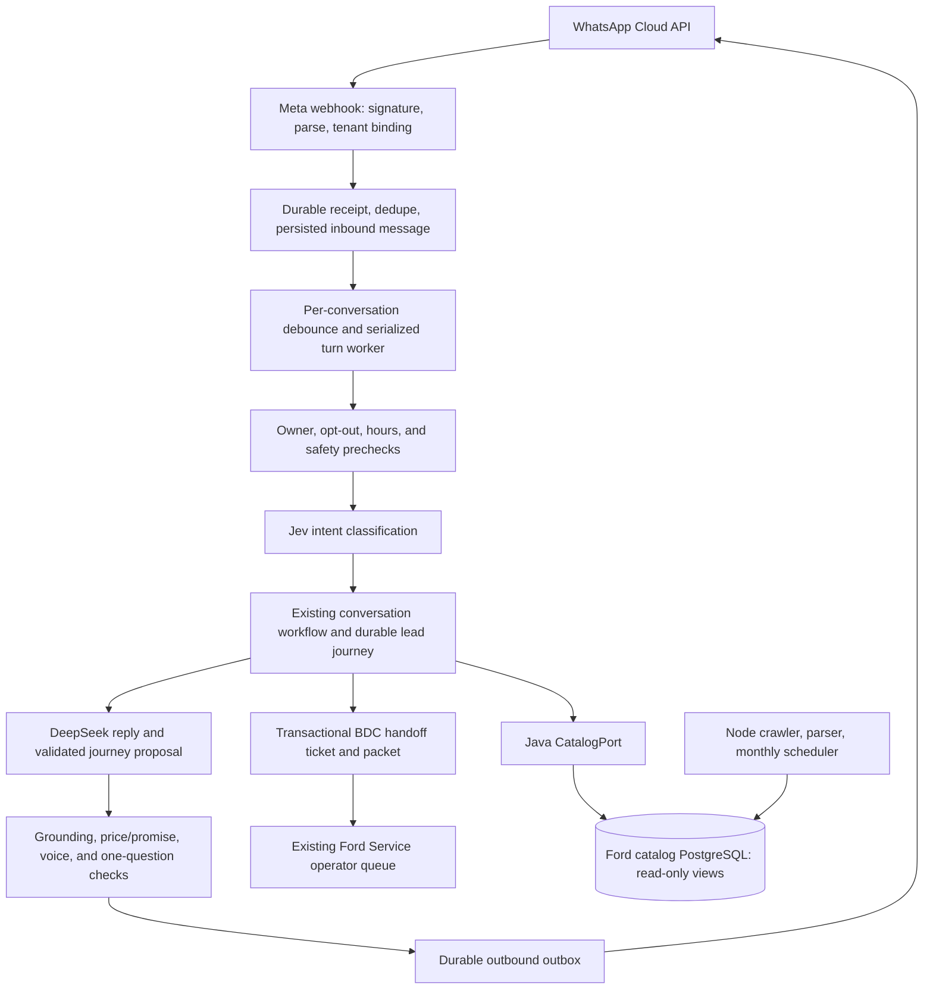

# MÍA Phase 1 Assistant Design

**Status:** Proposed for user review
**Date:** 2026-10-17
**Source:** `/Users/miguelangeldelgadillozarate/Downloads/MÍA — Ford Uruapan Assistant Flows, Architecture and Voice (1).md`

## Objective

Deliver the Phase 1 experience in the supplied MÍA document: WhatsApp new-car
sales, after-hours assistance, grounded catalog answers, and reliable handoff to
Ford Service's existing BDC queue. Keep the conversation natural, preserve
known user information across turns, and never claim an unverified fact or
external action.

This design incorporates the user's decisions during brainstorming:

- CRM contact/deal integrations and the 8:45 morning digest are out of scope.
- The bot must hand off to the existing BDC queue and give the customer an
  accurate handoff message.
- Use the document's hybrid catalog design: Java read path in Ford Service,
  Node remains the catalog ingestion and write owner.
- The five sales fields target a complete packet. A customer may interrupt,
  request a person, become upset, or decline twice; those cases hand off with a
  clearly partial packet rather than forcing completion.
- Preserve formal Mexican Spanish with **usted**, verified published catalog
  prices, and existing promotion behavior. Final quotes, negotiation,
  discounts, financing promises, delivery promises, and unit availability
  confirmation stay with an advisor.

## Phase 1 boundary

### Included

- WhatsApp entry, new-vehicle sales, after-hours responses, and BDC handoff.
- Existing conversation memory, lead journey, model/provider routing, MCP
  authorization, and durable outbound delivery, extended only where required.
- A Java read-only catalog path with contract/parity checks against the current
  Node MCP/catalog implementation.
- A useful BDC packet in the existing internal handoff queue, with partial and
  after-hours flags as applicable.
- A small code-owned template set for safety-critical messages, with the LLM
  composing ordinary conversation replies.
- Shadow evaluation, adversarial tests, launch gates, and an immediate return
  to human handling.

### Excluded

- External CRM integrations or contact/deal creation.
- The 8:45 BDC digest and external email/Slack/WhatsApp alerts.
- Messenger, website chat, Instagram, service, used vehicles, parts, business-
  hours overload backup, and automated follow-up nudges.
- Rewriting Node ingestion, crawler, scheduler, or migrations in Java.
- Automated appointment booking, vehicle reservation, credit approval, or
  appraisal.

The BDC queue remains the in-product operator workflow. This does not assert
that an external advisor was contacted or that the BDC has a separate alert
channel.

## Current implementation and design constraints

The service already has Meta signature validation, durable inbound deduplication
and persistence, Spring Modulith event processing, a bounded conversation
worker, durable outbound delivery, conversation memory, a persisted lead
journey, and a handoff ticket queue. The existing handoff ticket primarily
stores status, priority, reason, and conversation linkage; the lead journey
currently covers model/use, new-or-used, budget, timing, finance interest,
trade-in interest, and location. It does not yet represent the full five-field
packet as specified here.

The service has a Spring AI MCP client and an internal JDBC vehicle catalog.
That JDBC module queries Ford Service's own vehicle tables; it is not the
Ford-scraping catalog contract and must not be reused as if it were. The
conversation runtime should receive catalog data through a dedicated
`CatalogPort` implementation and a separately configured read-only datasource.

Ford-scraping remains the single writer for the TypeScript/Node catalog and its
21 migrations. It already owns Ford page ingestion, relational catalog facts,
offers/promotions, optional BGE-M3 embeddings, hybrid retrieval, provenance
URLs, and read-only MCP tools. Do not let Ford Service write to those tables or
run their migrations. The source review found durable inbound queueing but no
per-conversation WhatsApp debounce or dealership-hours/holiday engine.

The user has uncommitted contextual-follow-up changes in another Ford Service
worktree. This design must not overwrite or include those changes implicitly.

## Architecture

Keep the current Ford Service runtime as the sole conversation orchestrator.
Do not introduce a parallel chat service, a second agent framework, or a second
conversation-memory owner.

Jev remains the intent classifier. DeepSeek is the sole generative provider for
customer replies, per the user's prior provider decision; do not route a failed
DeepSeek response to another generative provider. On provider failure, use the
bounded safe response and accepted BDC handoff path. Application code owns
tenant isolation, tool allowlists, source freshness, accepted journey facts,
opt-out, handoff authorization, and side effects. The model interprets natural
language and composes the reply from the approved goal and evidence.

### Catalog read path

1. Freeze representative Node MCP request/response fixtures, including prices,
   effective dates, promotions, comparisons, empty results, stale results, and
   exact source URLs.
2. Implement a dedicated Java `CatalogPort` over stable SQL views using a
   second datasource and least-privilege read-only credentials. Use the
   project's supported `JdbcClient` for SQL access. Keep the existing Node MCP
   response contract as the parity reference.
3. Reuse the catalog's stored BGE-M3 vectors only when model tag, settings, and
   1024 dimensions match. Embed only incoming queries. Preserve the documented
   Spanish full-text/vector retrieval and 0.3/0.7 fusion; if embeddings are
   unavailable, return the supported lexical result rather than failing the
   entire lookup.
4. Add schema/view contract tests and Node-versus-Java parity tests for facts,
   prices, freshness, ranking, and byte-for-byte URLs. Do not cut over the chat
   path until the tests pass.
5. Keep Node as the sole schema/migration and data-write owner. Keep its MCP
   tools available to existing consumers. Spring AI tool adapters may call the
   Java `CatalogPort`; they do not expose unfiltered database results.

Freshness and price policy are applied before facts reach the model. A published
price may be stated only when the catalog returns that exact figure, validity,
model/trim, and source. Stale/expired prices are hidden. Promotions may be
described only from current existing catalog evidence. The bot never computes
monthly payments, financing eligibility, discounts, or final quotes. Inventory
search is not proof that a specific unit is available.

### Conversation and handoff behavior

- Introduce MÍA once as Ford Uruapan's virtual assistant; use warm, concise
  Mexican Spanish and formal **usted**. Match the customer's language when
  supported. Keep replies within three short lines, usually with one question
  at most and one allowed emoji at most; use none for an upset customer.
- Answer the customer's current request before qualification. Use known journey
  facts and transcript context; never re-ask a captured answer. A new customer
  topic takes precedence over an inferred previous goal.
- Capture the five packet targets: model, payment method, approximate down
  payment when financing, purchase timeframe, and name. Preserve both an
  accepted normalized value and the customer's words only where the BDC needs
  them. Do not store or log account, card, government-ID, or other unnecessary
  sensitive data.
- Ask at most one useful next question. A customer request for a person, an
  upset/complaint signal, or two refusals causes a handoff with the known facts
  and a `partial` marker. The model cannot independently authorize an external
  action or claim a human has accepted the ticket.
- Create the BDC ticket and its structured packet idempotently in the same
  durable turn boundary as the handoff state transition. Include known contact
  and source metadata, captured sales fields, lead-temperature reason, the
  remaining customer question, after-hours/partial/upset/test-drive flags, and
  a completeness count. Do not create an external CRM contact or deal.
- Send the customer a handoff message only after the queue ticket is committed
  and its outbound intent is durable. Wording may say the request is in the
  Ford Service team queue. It must not promise a reply time or claim an advisor
  was notified unless that separate delivery is proven.
- A human-owned conversation pauses bot replies. The existing operator claim,
  pause, resume, and audit behavior remains authoritative.

Conversation transcript rows remain the complete durable history. A bounded
working context and compact summary may support model calls, but no fixed
message-count threshold may delete or reset user history. Journey state remains
separate from the transcript and is tenant/conversation scoped. Only explicit,
validated user facts are written into it.

### WhatsApp operations and hours

- Persist every inbound provider message before delaying it. Debounce ordinary
  bursts for 4–6 seconds per conversation and process them in order as one
  response opportunity. Do not debounce opt-out, a direct human request, or an
  urgent complaint. Duplicate/retried Meta deliveries must never create a
  second answer or handoff.
- Compute hours and `next_open` in `America/Mexico_City`, using Mon–Fri
  09:00–19:00 and Sat 09:00–14:00 as the starting schedule. Sunday is closed.
  Do not assume national holidays; support an explicit dealership holiday and
  special-hours calendar. Until supplied, clearly treat holidays as an
  unresolved operations input.
- Outside hours, answer supported catalog questions, capture useful details,
  and place the ticket into the BDC queue. Do not implement the 8:45 digest in
  this phase. Do not promise the team will respond at a specific time unless
  the business confirms that service level.
- Keep the first-response target under one minute. Debounce, model, and tool
  budgets must fit within this target; failures produce a safe acknowledgment
  and an honest queue handoff where one is accepted.

## Privacy, diagnostics, and safety

- Keep raw customer prompts, generated text, summaries, PII, provider payloads,
  and catalog credentials out of application logs and tracing metadata.
- Log bounded turn outcomes: intent category, confidence band, tool names,
  evidence/freshness status, guardrail outcome, queue result, and latency.
- Honor opt-out and WhatsApp window rules through the current Meta adapter and
  approved template path. Show the supplied privacy notice before collecting
  personal details. The privacy URL and final wording are dealership inputs;
  do not invent them.
- Keep output validation in code. Unsafe or unsupported output gets one bounded
  repair attempt, then a safe response and handoff where applicable. Never
  silently say a message was sent or a ticket created if that action failed.

## Evaluation and rollout

Create a deterministic suite before changing behavior:

- One-question replies, valid short follow-ups, interruptions, corrections,
  repeated-question suppression, handoff requests, upset customers, two
  refusals, partial packet, duplicate/burst delivery, opt-out, and human-owned
  conversation.
- Catalog tests for current and stale facts, exact published prices and
  promotions, unknown trim/year, source links, empty results, MCP/DB timeout,
  Java/Node parity, and lexical fallback when embeddings are unavailable.
- At least 200 adversarial cases for price, discount, financing, availability,
  delivery promises, prompt injection, and provider/tool failure. The launch
  gate is zero never-promise violations.
- Handoff packet completeness above 80% on the golden set, and 95% of test
  first responses under one minute.
- A working kill switch that routes new conversations to humans and prevents
  new bot sends without deleting transcript or journey data.

Roll out through shadow mode first, where drafts are retained for authorized
human review and are not sent to customers. Move to live after-hours WhatsApp
only after the adversarial, latency, handoff, privacy, and operator dry-run
gates pass. Expand beyond after-hours only in a later approved phase.

The following evidence cannot be fabricated in code and remains required for a
live launch: 50–100 anonymized real conversations, advisor voice examples,
Meta first-response timestamps, BDC review of the packet, privacy-notice URL,
and the agency's holiday/special-hours calendar. A blind test and mystery-shop
result also require independent participants. This design does not claim these
inputs exist or that production rollout has happened.

## Delivery decomposition

The supplied Phase 1 document spans several separately verifiable changes. Use
one implementation plan per slice, in dependency order:

1. **Catalog evidence lane:** freeze the Node contract, build the Java read-only
   `CatalogPort`, and prove schema and result parity. Do not cut over replies
   until parity passes.
2. **Conversation and BDC packet:** align the existing model/policy flow,
   persist the five-field packet with the ticket, and verify idempotent customer
   handoff messages.
3. **WhatsApp operation:** add per-conversation debounce and dealership hours,
   next-open calculation, and holiday configuration without losing durable
   inbound receipts.
4. **Shadow and live gates:** provide a minimal human review surface in the
   existing operator inbox for unsent drafts, run the full evaluation set,
   collect dealership evidence, and document rollback.

Each slice keeps existing Ford Service and Ford-scraping work isolated. Do not
combine external CRM integration, the BDC digest, or later customer journeys
with these changes.

## Acceptance and exclusions

Phase 1 implementation is locally acceptable when the slice tests and the
combined service/MCP checks prove the stated behavior, the catalog parity
gate passes, and no existing unrelated test regresses. A live launch is
acceptable only when the external evidence and rollout gates above are
confirmed. Production release remains a separate action through the existing
protected deployment path; this design alone does not authorize or claim a
deployment.
