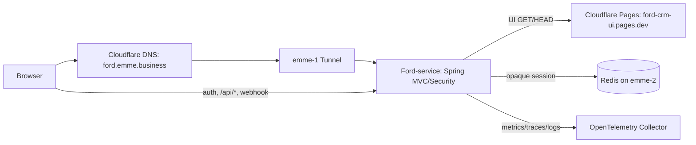

# BFF Consolidation Into Ford-service

## Goal

Run Ford-service and the existing OpenTelemetry Collector on emme-1. Remove the separate Ford-web BFF container after Spring takes over its browser authentication and API-session responsibilities. Serve the UI under `ford.emme.business` through Spring's existing Pages reverse proxy.

## Current State

- `ford.emme.business` DNS points to `ford-crm-ui.pages.dev`.
- Pages serves the React application and forwards selected auth/API paths through Pages Functions to `ford-origin.emme.business`.
- The Tunnel sends `ford-origin.emme.business/api/*` to Ford-web BFF on port 3001 and other paths to Ford-service on port 8080.
- The BFF performs the OAuth authorization-code exchange, stores an opaque `ford_session` in Redis, refreshes access tokens, applies CSRF checks, and forwards authorized API calls to Spring with JWTs.
- Spring already owns password, one-time-token, passkey, and OAuth authorization-server behavior. Its browser auth filter uses a server session; its API filter currently expects JWTs and operator authorization normalizes JWT claims.
- emme-1 currently runs Ford-service, Ford-web BFF, and `otel/opentelemetry-collector-contrib`. Keep the existing collector; it is not Grafana Alloy.
- PostgreSQL and Redis remain on emme-2. Redis continues to support Spring sessions and conversation memory.

## Approved Direction

Use Spring Security's existing operator authentication and Redis-backed server session directly for browser users. The browser keeps an opaque HttpOnly same-origin session cookie and Spring CSRF protection. The React app continues to load from Pages through the Spring UI proxy, but calls auth and API endpoints at the same origin. Spring API security accepts either the browser session or existing validated bearer JWTs; service-to-service clients keep their JWT contract.

Remove the BFF OAuth client flow and container only after equivalent Spring endpoints and authorization are verified. Keep the OpenTelemetry Collector. Do not change the existing OAuth authorization server or remove signing keys needed by external clients.

## Request Flow After Migration

## Required Spring and UI Behavior

1. Spring provides same-origin `/api/auth/me` and `/api/auth/logout` behavior using the authenticated Spring session. `/api/auth/csrf` and one-time-token generation remain Spring-owned.
2. Spring operator API authorization resolves session principals to an active `OperatorIdentity` from the database. Authorities, roles, and tenant membership come from that identity; never from browser headers.
3. Existing bearer JWT clients continue to authenticate as before. JWT tenant claims remain authoritative for those requests.
4. Cookie-authenticated unsafe requests require CSRF validation. Bearer-token requests remain usable by service clients without browser CSRF cookies.
5. Ford-web UI uses same-origin Spring auth/API endpoints and no longer depends on the BFF-specific `/api/auth/callback` or `ford_session` cookie.
6. `/webhooks/meta/**` is served by Spring after DNS cutover. The webhook must return Meta's challenge or the controller's actual rejection status, never a React HTML fallback.
7. Spring continues proxying UI GET/HEAD to the Pages `pages.dev` origin. The browser must remain on `ford.emme.business`.

## Deployment and Cutover

1. Add Spring session auth/API support and tests while the BFF remains deployed.
2. Update Ford-web to use Spring session endpoints and preserve JWT clients.
3. Deploy both with rollback images retained; verify password, passkey, one-time-token, session resume, logout, CSRF, representative API reads/writes, SSE, and bearer JWT service calls.
4. Change Tunnel routing so `ford.emme.business` goes to Ford-service on port 8080. Keep the OpenTelemetry Collector.
5. Change `ford.emme.business` DNS from Pages to the existing proxied Tunnel target. Verify UI assets, login, API, webhook, and OAuth discovery through the public hostname.
6. Remove BFF from Compose, its registry image/config, and the obsolete `ford-origin` Tunnel/DNS routes after public checks pass. Keep the Pages `pages.dev` deployment as the UI upstream.

The Cloudflare token currently available can edit Tunnel configuration but receives an authentication error for DNS record APIs. DNS cutover requires a token with Zone DNS Edit for `emme.business`; the token must stay in private deployment configuration and must not be pasted into chat.

## Non-Goals

- Removing PostgreSQL, Redis, or the OpenTelemetry Collector.
- Replacing browser session cookies with JWTs in browser storage.
- Changing the external bearer-JWT API contract or OAuth issuer.
- Moving React source into the Ford-service repository/image.
- Deploying the cutover before session/API tests and DNS access are ready.

## Acceptance Criteria

- Only Ford-service and the existing OpenTelemetry Collector remain as application/telemetry containers on emme-1.
- Password, passkey, and one-time-token login work directly with Spring; browser session survives requests and server restarts according to Spring Session Redis policy.
- Browser session users can access the same authorized CRM endpoints as before, with CSRF checks on unsafe requests.
- Existing bearer JWT clients retain their current authentication and tenant authorization behavior.
- UI, auth, API, and WhatsApp webhook use `ford.emme.business`; Pages is only the server-side UI source.
- No production request requires `ford-origin.emme.business` or the Ford-web BFF container.
