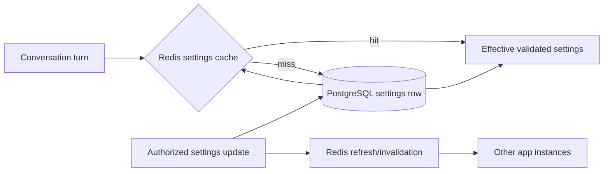

# Conversation Restart and Runtime Configuration

## Goal

Let authorized advisors restart the bot context for one conversation from Ford-web without deleting its transcript. Store approved business behavior settings in PostgreSQL and use Redis as a distributed cache so ordinary turns do not reread those settings from PostgreSQL.

## Current State

- `conversation_message` stores the durable transcript.
- `conversation_memory` stores the summary, structured facts, version, and last update time.
- `RedisCachedConversationMemoryPort` caches summaries and recent messages by conversation key.
- Semantic conversation memories are stored in `conversation_memory_item` and `conversation_memory_embedding`.
- Ford-web supports takeover and handback, but has no bot-context restart action.
- `BotConfigurationController` reports several environment-backed values. It does not update them.
- The system prompt is already stored in PostgreSQL. Memory, handoff, model providers, and infrastructure are primarily deployment configuration.

## Approved Direction

### Conversation restart

Add an authorized, version-checked restart action to the conversation UI. It starts a new memory epoch for the selected conversation. The operation clears its summary and structured memory facts, marks semantic memory rows from the old epoch inactive, and prevents pre-restart messages from entering future bot context. The transcript remains visible and queryable in CRM for audit and advisor reference.

The operation does not create a new provider conversation or change the WhatsApp identity. It does not change the conversation's bot/human ownership state. It is available only when the bot can respond (`BOT_ACTIVE` or `LEAD_CAPTURE`). If a turn lease is active, the API returns a conflict and makes no change. The UI refreshes its authoritative conversation data after a successful reset.

The reset uses the authenticated operator's tenant authorization, conversation version (`If-Match`), and an idempotency key. The server stores reset time, actor, and epoch/version. It publishes a metadata-only `conversation.updated` event after commit and evicts that conversation's Redis memory entry after the durable reset succeeds.

### Runtime settings

PostgreSQL is the source of truth for validated, tenant-scoped business settings. A typed Java configuration object is serialized to a versioned JSONB row with `tenant_id`, `revision`, `updated_at`, and `updated_by`. Updates require an authorized configuration role, validate a strict allowlist and ranges, and use optimistic revision checks. The system prompt remains in its existing table and workflow.

Redis stores the effective configuration by tenant and revision. Reads use Redis; a cache miss loads PostgreSQL and repopulates Redis. Successful updates commit to PostgreSQL, refresh or invalidate the Redis entry, and publish a revision invalidation for other app instances. A short TTL bounds stale settings if an invalidation is missed. If Redis is unavailable, the service reads PostgreSQL and continues; Redis is not the only copy of configuration.

Initial database-controlled settings are limited to business behavior that can safely change without rebuilding Spring beans: human-handoff enablement, conversation-memory enablement and context window limits, and semantic memory/recall limits. Provider credentials, API keys, database URLs, ports, thread pools, provider endpoints, and other infrastructure settings remain in environment or secret management. Provider/model switching is excluded until the application has a validated dynamic provider registry.

## Request Flows

### Advisor restart

```mermaid
sequenceDiagram
    participant UI as Ford-web
    participant API as Ford-service
    participant DB as PostgreSQL
    participant Redis
    participant SSE as Operator SSE

    UI->>API: POST restart + tenant + If-Match + Idempotency-Key
    API->>API: authorize operator; acquire conversation turn lease
    API->>DB: set new memory epoch; clear summary/facts; deactivate old semantic rows
    DB-->>API: commit
    API->>Redis: evict conversation memory
    API-->>SSE: conversation.updated (metadata only)
    API-->>UI: reset receipt and new version
    UI->>API: refetch conversation and messages
```

### Runtime setting read/update



## API and UI Contract

- `POST /api/v1/conversations/{conversationId}/restart` uses the authenticated browser session, tenant access check, `If-Match`, CSRF protection, and `Idempotency-Key`.
- Success returns the conversation ID, new conversation version, memory epoch start time, and reset outcome. It does not return transcript text.
- Stale versions, active bot turns, non-bot-owned states, or unauthorized tenants do not reset memory.
- Ford-web adds a clearly labeled “Reiniciar contexto del bot” action with a confirmation that transcript messages remain visible while prior context and learned memory are cleared.
- The UI refreshes the selected conversation and transcript after success and displays a recoverable conflict if a bot turn is active.
- Runtime configuration reads and writes use an admin-authorized API and report effective revision and last updater/time. UI controls expose only the allowlisted settings.

## Data and Cache Invariants

1. `conversation_message` rows are never deleted by restart.
2. Bot context includes only messages at or after the current conversation memory epoch.
3. Summaries, durable facts, and semantic memories from an earlier epoch cannot be recalled after restart.
4. A reset is durable before Redis eviction and SSE notification.
5. Runtime settings remain correct if Redis is unavailable; PostgreSQL remains authoritative.
6. No provider credentials or arbitrary unvalidated JSON values are exposed through the configuration API.

## Testing and Acceptance

- Unit tests prove reset clears summaries/facts and excludes older messages while preserving transcript rows.
- Repository tests prove reset is tenant-scoped, versioned, and deactivates old semantic memories.
- Command/API tests cover RBAC, CSRF-compatible request shape, stale versions, duplicate idempotency keys, active turn leases, and unsupported conversation states.
- Runtime configuration tests cover database fallback, Redis hit, update invalidation, version conflicts, validation bounds, and Redis outage.
- Ford-web tests cover the restart confirmation, success refresh, and active-turn conflict.
- Integration tests exercise the complete reset and config flows against PostgreSQL and Redis.
- Production acceptance verifies a single WhatsApp thread retains its transcript, the next bot response excludes pre-reset context, the CRM refreshes over SSE, and the advisor can still inspect earlier messages.

## Non-Goals

- Deleting transcripts or changing WhatsApp/provider conversation identity.
- Using Redis as the sole durable settings store.
- Storing credentials, API keys, hostnames, or infrastructure tuning in the runtime settings table.
- Dynamically creating new LLM provider connections or changing API endpoints without a separate provider-registry design.
- Claiming an advisor has been notified externally; the existing handoff queue/UI remains the authoritative handoff workflow.
